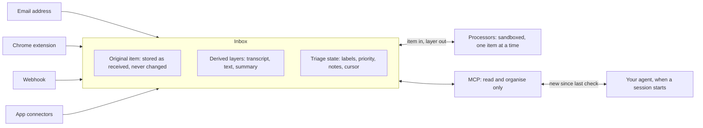

# Scoop: product plan

Nov 13, 2026 · David

## Summary

Scoop is a personal inbox for your AI agent. It collects things from the world while the agent is not running, and the agent reads, searches and organises them over MCP whenever a session starts.

- **Who it is for:** one person who works with agents every day. It is not a team workflow tool.
- **What goes in:** email sent to the agent's own address, pages and links saved from a Chrome extension, webhooks, and later app connectors such as Slack.
- **What the agent does:** asks what is new since it last looked, then searches, labels, prioritises and annotates.
- **What it never does:** send, post or pay. Acting on an item goes through a separate, approved path.
- **First version:** the email address, a generic add-item endpoint, and the MCP. The Chrome extension follows.

The name is Scoop, at `scoop.davidsling.in`. It has not been checked for trademarks or clashing products yet.

The logo is David's scoop character with the name "scoop" tucked into its notch, in mauve `#9F527C` on pink `#FFABDA`. The main style is Tidy, with pink letters and white o's inside a mauve outline: `brand/lockup-v2/scoop-lockup-tidy.svg`. The Solid style, in plain mauve, is only for places where the outline cannot be used. Row, wordmark and icon files are beside it, and `brand/lockup-v2/README.md` says when to use each. The earlier S mark in `brand/logo/` is retired.

Type: Rubik for headlines, DM Sans for body text and DM Mono for addresses and code. All three are free on Google Fonts.

## Problem and positioning

An agent only exists during a session, but the world sends things all day. Newsletters, Slack messages, shared links and replies arrive when no agent is running, and most of them are lost or sit unread in tools the agent cannot see.

Scoop is the durable buffer between the two. It queues everything, and the agent catches up when it next wakes.

**How it differs from what exists**

- **Read-later apps** are built for a person to read. Here the reader is the agent.
- **Automation tools** run a workflow the moment an event fires. Here nothing runs until the agent, with the person present, decides what matters.

**How it fits the other tools**

The AI infrastructure page asks "Who's on the other side?". Wave answers "another agent" and Valet answers "a person with no agent". Scoop answers "nobody yet".

Wave messages sent to an offline agent and Valet approval requests can land in the inbox too. That makes it the shared async layer under the other tools, not a separate fourth product.

## How it works

Every source produces the same kind of item, and the only way out is an MCP that reads and organises.

Four sources add items. Processors add layers beside the original. The agent reaches the inbox only through the MCP. All content is marked untrusted.

- **One item shape.** A Slack message, a newsletter, a saved page and an email become the same record: source, sender, time, original content, state, labels and priority.
- **Originals never change.** A transcript or summary is a layer added beside the original, so a processor can be re-run or removed without loss.
- **A cursor per agent.** The inbox remembers where each agent stopped reading, so "what's new" is one call.
- **Notes that persist.** Labels, priorities and notes written by the agent stay on the item for the next session.
- **Trust is recorded, not guessed.** Each item carries its source and a trust level. The person's own capture note is trusted. Everything else is untrusted data.

## Getting things in

Four routes feed the inbox, and all four end at the same add-item endpoint.

| Route | Covers | Effort | Phase |
| --- | --- | --- | --- |
| Email address | Newsletters, receipts, forwards, any app that sends email notifications | Low | 1 |
| Generic webhook URL | Anything that can send an HTTP POST | Low | 1 |
| Chrome extension | Pages, selections, YouTube and Instagram links, paywalled or signed-in content | Medium | 2 |
| OAuth connectors (Slack, GitHub, calendar) | Rich, structured events | High, per app | 4 |

**Email address**

- Each person gets `username@scoop.davidsling.in`. The site and the MCP live at the same subdomain.
- Per-source aliases such as `username+slack@` identify each source and can be revoked one at a time.
- Mail from unknown senders goes to quarantine, not the main queue.

**Chrome extension**

- **Capture on a user action only.** One click, a shortcut, or right-click on a selection. No background reading of tabs or history, so it needs only the `activeTab` permission.
- **A note at capture time.** A short "why I saved this" line is trusted, because the person wrote it. The page content is not.
- **Reads the page as the person sees it.** That covers signed-in and paywalled pages without any scraping from the backend.
- **A token that can only add.** The extension cannot read the inbox, so a compromised extension leaks nothing.
- **A blocklist for sensitive sites.** Banking, health and password manager pages are off by default, with a preview of what will be sent.

**Later capture routes:** a phone share sheet and a chat bot that accepts links. Both reuse the same endpoint.

## The MCP

The MCP lets the agent read and organise the inbox, and nothing else. It has no tool that sends, posts or pays.

| The agent can | Why |
| --- | --- |
| Ask what is new since its last check | The main call. Each agent keeps its own cursor. |
| Search by text, source, sender, label and date | Find something saved weeks ago. |
| Read one item with its derived layers | Original, transcript and summary, each marked with where it came from. |
| Label, prioritise, snooze and mark done, in batches | Triage a morning's backlog in one pass. |
| Write a note on an item | Tomorrow's session inherits today's thinking. |
| Release or block a quarantined sender | Only on the person's instruction. |

**What it deliberately cannot do**

- Reply to an email, post to Slack or call a webhook.
- Change connector settings or tokens.
- Delete an original. It can only archive.

Acting on an item is a separate step through a tool with its own approval, which is where Valet fits.

## Processors and the marketplace

Build the contract first and the marketplace last. A marketplace has a cold-start problem on both sides, so the first ten connectors and processors are written in-house against the same contract third parties will later use.

**Two kinds of extension**

- **Connectors** bring items in from one app.
- **Processors** take an item and add a derived layer: a transcript, extracted article text, OCR, a summary, a duplicate check.

**The contract**

- **A manifest.** It declares what the extension reads, which scopes it needs, what it emits, and which hosts it may contact.
- **A sandbox.** A processor gets one item in and returns one layer out. It has no network access beyond what the manifest declares, and no access to other items.
- **Deterministic routing.** Rules decide which processors run on which items. A model reading the content never decides.
- **Per-use pricing for add-ons.** Transcription, OCR and summaries have real costs, so they are metered.

**First set to build in-house**

| Kind | Name | Notes |
| --- | --- | --- |
| Processor | Article text extraction | Runs on saved pages and newsletter emails |
| Processor | Duplicate detection | Same link saved twice, same newsletter issue |
| Processor | Transcription | Paid add-on. Captions first where they exist |
| Processor | Summary | Paid add-on. Output is marked as model-written |
| Connector | Slack | Mentions and saved messages only, to start |
| Connector | GitHub | Notifications |

Third parties are invited once this contract has survived the in-house set without a breaking change.

## Security and privacy

The main risk is prompt injection. Everything in the inbox is written by strangers and read by an agent, and anyone can email the address. The design assumes hostile content from day one.

| Risk | Control |
| --- | --- |
| An item tells the agent to do something | The MCP is read and organise only. Every item is returned as untrusted data with its source. |
| A stranger floods or targets the address | Sender trust levels. Unknown senders go to quarantine. Rate limits apply per sender and per alias. |
| A model-written summary relays an injection | Summaries carry the same untrusted label as the content they came from. |
| One person's items reach another person | Every request is checked on the backend against the signed-in user and the item's owner. Nothing relies on the client. |
| A connector token leaks | Tokens are encrypted at rest, scoped to the minimum, and never returned through the MCP. |
| The extension is compromised | Its token can only add items. It cannot read. |
| A third-party processor misbehaves | Sandbox, declared hosts only, one item at a time. |
| Sensitive pages are captured by accident | Capture on user action only, a default blocklist, and a preview before sending. |

**Also required**

- **An audit log.** Who or what added, read, changed or released each item, and when.
- **Real deletion.** Deleting an item removes the original and every derived layer. Retention periods are set per source.
- **Rules decide, not models.** Routing, quarantine and first-pass priority are deterministic. This matches the line on the infrastructure page: use AI to build, use deterministic systems to guard.

Personal email and private messages are sensitive personal data. Before launch, get a privacy and terms review from someone qualified. This plan is not that review.

## Build order

Five phases, each usable on its own. No dates are set yet.

1. **Core: email, endpoint and MCP.**
   - The item store, the add-item endpoint, the inbound email address with aliases, quarantine, and the MCP's read and organise tools.
   - Done when: an agent can ask "what's new since yesterday", triage it, and find the same labels and notes in the next session.
2. **Chrome extension.**
   - Save page, save selection, capture note, blocklist and preview.
   - Done when: it passes Chrome Web Store review with `activeTab` only.
3. **Processors.**
   - The processor contract and sandbox, then article extraction, duplicate detection, transcription and summary.
   - Done when: a processor can be removed and re-run without touching any original.
4. **Connectors.**
   - The connector contract, then Slack and GitHub.
   - Done when: both are built on the public contract with no private shortcuts.
5. **Marketplace.**
   - Third-party submission, review and listing, plus metered billing for add-ons.
   - Done when: one outside developer ships an extension without help.

Wave and Valet delivery into the inbox can follow phase 1 at any point, since both only need the add-item endpoint.

## Risks and open decisions

**Risks**

- **Instagram and YouTube terms.** Instagram has no clean API for arbitrary posts, and downloading media from either may breach their terms. The plan is to store the link, visible metadata and captions, not the video. This needs checking before transcription ships.
- **Email deliverability and abuse.** A public address attracts spam. Quarantine and rate limits are in phase 1 for this reason.
- **Connector upkeep.** Each OAuth connector needs app review and ongoing maintenance. This is why they come fourth.
- **Crowded neighbours.** Read-later and automation tools sit close by. The agent-as-reader position has to be clear on the first screen.

**Open decisions**

- [ ] Trademark and name-clash check for Scoop.
- [ ] Hosted only, or a self-hosted option for people who will not send personal mail to a third party.
- [ ] Pricing: free core with paid add-ons, or a flat subscription.
- [ ] Whether the first Slack connector reads mentions only or whole channels.
- [ ] Default retention period per source.
- [ ] Whether one person can have several agents with separate cursors from day one.
