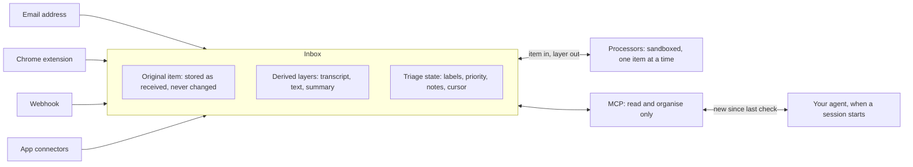

# Scoop: product plan

Nov 13, 2026 · David

## Summary

Scoop is a personal library for your AI agent. You fill it with things you like and things worth knowing, and your agent draws on it over MCP when a project needs ideas.

- **Who it is for:** one person who makes things with agents every day, starting with designers and developers. It is not a team tool and it is not a task manager.
- **What goes in:** posts, pages, videos and images saved with one click from a Chrome extension, and newsletters sent to the agent's own address.
- **What the agent does:** searches the library for what fits the project in front of it, reads those items, and learns your taste from what you chose to save.
- **What it never does:** send, post or pay. Project decisions do not live in Scoop either. They go in the project's own report.
- **First version:** the Chrome extension, the email address for newsletters, and the MCP.

The name is Scoop, at `scoop.davidsling.in`. It has not been checked for trademarks or clashing products yet.

The logo is David's scoop character with the name "scoop" tucked into its notch, in mauve `#9F527C` on pink `#FFABDA`. The main style is Tidy, with pink letters and white o's inside a mauve outline: `brand/lockup-v2/scoop-lockup-tidy.svg`. The Solid style, in plain mauve, is only for places where the outline cannot be used. Row, wordmark and icon files are beside it, and `brand/lockup-v2/README.md` says when to use each. The earlier S mark in `brand/logo/` is retired.

Type: Rubik for headlines, DM Sans for body text and DM Mono for addresses and code. All three are free on Google Fonts.

> **Direction changed on Nov 26, 2026.** David described the real use: saving inspiration and resources now, and having an agent pull from them when a project starts. The summary, the positioning, the MCP section and the build order are updated for that. The sections on how it works, getting things in, processors and security were written for the earlier inbox framing. Their mechanics still apply, but they have not been rewritten.

## How someone uses it

1. **Subscribe.** Newsletters about new AI tools, animation libraries and component libraries go to the agent's address, so they arrive in Scoop and not in a personal mailbox.
2. **Save while browsing.** A post, video, site or image looks good. One click on the Chrome extension saves it, with an optional line on why. Then the person carries on with their day.
3. **Start a project.** In the design phase, the person asks their agent to go through the library and pick what fits this product.
4. **Decide elsewhere.** The agent's choices and the reasons go in the project report. Scoop only supplied the material.

Over time the library also shows the agent what the person's taste is, because every item in it was chosen by them.

## Problem and positioning

Good references turn up while you are doing something else: scrolling, reading a newsletter, watching a video. By the time a project starts, they are scattered across bookmarks, likes and old emails, and an agent can see none of them.

Scoop keeps them in one place, in a form an agent can search and read.

**How it differs from what exists**

- **Bookmarking and read-later apps** are built for a person to browse. Here the main reader is the agent, and it arrives with a project in mind.
- **Task and automation tools** are about getting things done. Scoop holds no tasks, sends no reminders and runs no workflows.

**How it fits the other tools**

Wave lets an agent talk to another agent, and Valet lets it work with a person who has no agent. Scoop gives it something to draw on: what its own person has collected.

## How it works

Every source produces the same kind of item, and the only way out is an MCP that reads and organises.

Four sources add items. Processors add layers beside the original. The agent reaches the inbox only through the MCP. All content is marked untrusted.

- **One item shape.** A Slack message, a newsletter, a saved page and an email become the same record: source, sender, time, original content, state, labels and priority.
- **Originals never change.** A transcript or summary is a layer added beside the original, so a processor can be re-run or removed without loss.
- **A cursor per agent.** The inbox remembers where each agent stopped reading, so "what's new" is one call.
- **Notes that persist.** Labels, priorities and notes written by the agent stay on the item for the next session.
- **Trust is recorded, not guessed.** Each item carries its source and a trust level. The person's own capture note is trusted. Everything else is untrusted data.

## Getting things in

Four routes feed the inbox, and all four end at the same add-item endpoint.

| Route | Covers | Effort | Phase |
| --- | --- | --- | --- |
| Email address | Newsletters, receipts, forwards, any app that sends email notifications | Low | 1 |
| Generic webhook URL | Anything that can send an HTTP POST | Low | 1 |
| Chrome extension | Pages, selections, YouTube and Instagram links, paywalled or signed-in content | Medium | 2 |
| OAuth connectors (Slack, GitHub, calendar) | Rich, structured events | High, per app | 4 |

**Email address**

- Each person gets `username@scoop.davidsling.in`. The site and the MCP live at the same subdomain.
- Per-source aliases such as `username+slack@` identify each source and can be revoked one at a time.
- Mail from unknown senders goes to quarantine, not the main queue.

**Chrome extension**

- **Capture on a user action only.** One click, a shortcut, or right-click on a selection. No background reading of tabs or history, so it needs only the `activeTab` permission.
- **A note at capture time.** A short "why I saved this" line is trusted, because the person wrote it. The page content is not.
- **Reads the page as the person sees it.** That covers signed-in and paywalled pages without any scraping from the backend.
- **A token that can only add.** The extension cannot read the inbox, so a compromised extension leaks nothing.
- **A blocklist for sensitive sites.** Banking, health and password manager pages are off by default, with a preview of what will be sent.

**Later capture routes:** a phone share sheet and a chat bot that accepts links. Both reuse the same endpoint.

## The MCP

The MCP lets the agent search, read and organise the library, and nothing else. It has no tool that sends, posts or pays.

| The agent can | Why |
| --- | --- |
| Search by meaning, kind, topic, source and date | The main call: "what do I have on playful hover animations?" |
| Read one item with its derived layers | Original, extracted text, transcript and summary, each marked with where it came from. |
| Read the person's own note on an item | The note says why it was saved, which is the best signal of taste. |
| Ask for a taste summary on a subject | A model-written description of what the person tends to save, marked as model-written. |
| Add topics and a note to an item | The next session finds it faster. |
| Record which items it used for a project | The person can see what was pulled, and the item gains context. |
| List what is new since it last looked | Useful for newsletters, but no longer the main call. |

**What it deliberately cannot do**

- Reply to an email, post anywhere or call a webhook.
- Change connector settings or tokens.
- Delete an original. It can only archive.
- Store project decisions. Those belong in the project's own files.

## Processors and the marketplace

Build the contract first and the marketplace last. A marketplace has a cold-start problem on both sides, so the first ten connectors and processors are written in-house against the same contract third parties will later use.

**Two kinds of extension**

- **Connectors** bring items in from one app.
- **Processors** take an item and add a derived layer: a transcript, extracted article text, OCR, a summary, a duplicate check.

**The contract**

- **A manifest.** It declares what the extension reads, which scopes it needs, what it emits, and which hosts it may contact.
- **A sandbox.** A processor gets one item in and returns one layer out. It has no network access beyond what the manifest declares, and no access to other items.
- **Deterministic routing.** Rules decide which processors run on which items. A model reading the content never decides.
- **Per-use pricing for add-ons.** Transcription, OCR and summaries have real costs, so they are metered.

**First set to build in-house**

| Kind | Name | Notes |
| --- | --- | --- |
| Processor | Article text extraction | Runs on saved pages and newsletter emails |
| Processor | Duplicate detection | Same link saved twice, same newsletter issue |
| Processor | Transcription | Paid add-on. Captions first where they exist |
| Processor | Summary | Paid add-on. Output is marked as model-written |
| Connector | Slack | Mentions and saved messages only, to start |
| Connector | GitHub | Notifications |

Third parties are invited once this contract has survived the in-house set without a breaking change.

## Security and privacy

The main risk is prompt injection. Everything in the inbox is written by strangers and read by an agent, and anyone can email the address. The design assumes hostile content from day one.

| Risk | Control |
| --- | --- |
| An item tells the agent to do something | The MCP is read and organise only. Every item is returned as untrusted data with its source. |
| A stranger floods or targets the address | Sender trust levels. Unknown senders go to quarantine. Rate limits apply per sender and per alias. |
| A model-written summary relays an injection | Summaries carry the same untrusted label as the content they came from. |
| One person's items reach another person | Every request is checked on the backend against the signed-in user and the item's owner. Nothing relies on the client. |
| A connector token leaks | Tokens are encrypted at rest, scoped to the minimum, and never returned through the MCP. |
| The extension is compromised | Its token can only add items. It cannot read. |
| A third-party processor misbehaves | Sandbox, declared hosts only, one item at a time. |
| Sensitive pages are captured by accident | Capture on user action only, a default blocklist, and a preview before sending. |

**Also required**

- **An audit log.** Who or what added, read, changed or released each item, and when.
- **Real deletion.** Deleting an item removes the original and every derived layer. Retention periods are set per source.
- **Rules decide, not models.** Routing, quarantine and first-pass priority are deterministic. This matches the line on the infrastructure page: use AI to build, use deterministic systems to guard.

Personal email and private messages are sensitive personal data. Before launch, get a privacy and terms review from someone qualified. This plan is not that review.

## Build order

Five phases, each usable on its own. No dates are set yet.

1. **Core: capture, store and MCP.**
   - The item store, the Chrome extension (save page, selection, post, image or video link, with a note), the email address for newsletters with quarantine, and the MCP's search and read tools.
   - Done when: something saved on Monday can be found by an agent on Friday from a plain description of it.
2. **Processors for recall.**
   - Text and media extraction for posts and pages, video transcripts, search by meaning, and automatic topics.
   - Done when: a search for an idea finds items that never use those words.
3. **Taste.**
   - The taste summary, and the record of which items were used for which project.
   - Done when: an agent starting a new project can describe the person's preferences from the library alone.
4. **Connectors.**
   - The connector contract, then sources beyond the extension and email.
   - Done when: each is built on the public contract with no private shortcuts.
5. **Marketplace.**
   - Third-party submission, review and listing, plus metered billing for add-ons.
   - Done when: one outside developer ships an extension without help.

## Risks and open decisions

**Risks**

- **Instagram and YouTube terms.** Instagram has no clean API for arbitrary posts, and downloading media from either may breach their terms. The plan is to store the link, visible metadata and captions, not the video. This needs checking before transcription ships.
- **Email deliverability and abuse.** A public address attracts spam. Quarantine and rate limits are in phase 1 for this reason.
- **Connector upkeep.** Each OAuth connector needs app review and ongoing maintenance. This is why they come fourth.
- **Crowded neighbours.** Bookmarking and read-later tools sit very close by. The agent-as-reader position has to be clear on the first screen.
- **Capturing posts.** Saving a post from X or Instagram depends on what the extension can read on the page, and those sites change often. Their terms on storing content need checking.

**Open decisions**

- [ ] Trademark and name-clash check for Scoop.
- [ ] Hosted only, or a self-hosted option for people who will not send personal mail to a third party.
- [ ] Pricing: free core with paid add-ons, or a flat subscription.
- [ ] Which connectors still matter for a library. Slack and GitHub notifications were planned for the inbox framing.
- [ ] Whether the taste summary is on by default or opt-in.
- [ ] Default retention period per source.
- [ ] Whether one person can have several agents with separate cursors from day one.
