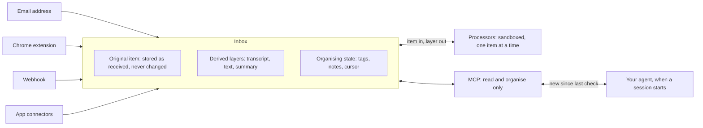

# Scoop: product plan

Nov 13, 2026 · David

## Summary

Scoop is a personal library for your AI agent. You fill it with things you like and things worth knowing, and your agent draws on it over MCP when a project needs ideas.

- **Who it is for:** one person who makes things with agents every day, starting with designers and developers. It is not a team tool and it is not a task manager.
- **What goes in:** posts, pages, videos and images saved with one click from a Chrome extension, and newsletters sent to the agent's own address.
- **What the agent does:** tags new saves, searches the library for what fits the project in front of it, reads those items, and learns your taste from what you chose to save.
- **No AI inside Scoop.** Scoop stores and serves. It does not tag, summarise or transcribe, because your agent does that better. A new save stays untagged until an agent, or you, tags it.
- **What it never does:** send, post or pay. Project decisions do not live in Scoop either. They go in the project's own report.
- **First version:** the Chrome extension, the email address for newsletters, and the MCP.

The name is Scoop, at `scoop.davidsling.in`. It has not been checked for trademarks or clashing products yet.

The logo is David's scoop character with the name "scoop" tucked into its notch, in mauve `#9F527C` on pink `#FFABDA`. The main style is Tidy, with pink letters and white o's inside a mauve outline: `brand/lockup-v2/scoop-lockup-tidy.svg`. The Solid style, in plain mauve, is only for places where the outline cannot be used. Row, wordmark and icon files are beside it, and `brand/lockup-v2/README.md` says when to use each. The earlier S mark in `brand/logo/` is retired.

Type: Rubik for headlines, DM Sans for body text and DM Mono for addresses and code. All three are free on Google Fonts.

> **Direction changed on Nov 26, 2026.** David described the real use: saving inspiration and resources now, and having an agent pull from them when a project starts. The summary, the positioning, the MCP section, the processors section and the build order are updated for that, and for the rule that Scoop runs no AI of its own. The sections on how it works, getting things in and security were written for the earlier inbox framing. Their mechanics still apply, but they have not been rewritten.

## How someone uses it

1. **Subscribe.** Newsletters about new AI tools, animation libraries and component libraries go to the agent's address, so they arrive in Scoop and not in a personal mailbox.
2. **Save while browsing.** A post, video, site or image looks good. One click on the Chrome extension saves it, with an optional line on why. Then the person carries on with their day.
3. **Start a project.** The person creates a project in Scoop and adds the saves they want used. In the design phase they point their agent at it, and can also ask the agent to go through the whole library and add what fits.
4. **Decide elsewhere.** The agent's decisions and the reasons go in the project report. Scoop keeps only which saves were used and a short note on how.

Over time the library also shows the agent what the person's taste is, because every item in it was chosen by them.

## Problem and positioning

Good references turn up while you are doing something else: scrolling, reading a newsletter, watching a video. By the time a project starts, they are scattered across bookmarks, likes and old emails, and an agent can see none of them.

Scoop keeps them in one place, in a form an agent can search and read.

**How it differs from what exists**

- **Bookmarking and read-later apps** are built for a person to browse. Here the main reader is the agent, and it arrives with a project in mind.
- **Task and automation tools** are about getting things done. Scoop holds no tasks, sends no reminders and runs no workflows.

**How it fits the other tools**

Wave lets an agent talk to another agent, and Valet lets it work with a person who has no agent. Scoop gives it something to draw on: what its own person has collected.

## How it works

Every source produces the same kind of item, and the only way out is an MCP that reads and organises.

Four sources add items. Processors add layers beside the original. The agent reaches the inbox only through the MCP. All content is marked untrusted.

- **One item shape.** A Slack message, a newsletter, a saved page and an email become the same record: source, sender, time, original content, tags and notes.
- **Originals never change.** A transcript or summary is a layer added beside the original, so a processor can be re-run or removed without loss.
- **A cursor per agent.** The inbox remembers where each agent stopped reading, so "what's new" is one call.
- **Tags and notes that persist.** Tags and notes written by an agent or by the person stay on the item for the next session.
- **Trust is recorded, not guessed.** Each item carries its source and a trust level. The person's own capture note is trusted. Everything else is untrusted data.

## Getting things in

Four routes feed the inbox, and all four end at the same add-item endpoint.

| Route | Covers | Effort | Phase |
| --- | --- | --- | --- |
| Email address | Newsletters, receipts, forwards, any app that sends email notifications | Low | 1 |
| Generic webhook URL | Anything that can send an HTTP POST | Low | 1 |
| Chrome extension | Pages, selections, YouTube and Instagram links, paywalled or signed-in content | Medium | 2 |
| OAuth connectors (Slack, GitHub, calendar) | Rich, structured events | High, per app | 4 |

**Email address**

- Each person gets `username@scoop.davidsling.in`. The site and the MCP live at the same subdomain.
- Per-source aliases such as `username+slack@` identify each source and can be revoked one at a time.
- Mail from unknown senders goes to quarantine, not the main queue.

**Chrome extension**

- **Capture on a user action only.** One click, a shortcut, or right-click on a selection. No background reading of tabs or history, so it needs only the `activeTab` permission.
- **A note at capture time.** A short "why I saved this" line is trusted, because the person wrote it. The page content is not.
- **Reads the page as the person sees it.** That covers signed-in and paywalled pages without any scraping from the backend.
- **A token that can only add.** The extension cannot read the inbox, so a compromised extension leaks nothing.
- **A blocklist for sensitive sites.** Banking, health and password manager pages are off by default, with a preview of what will be sent.

**Later capture routes:** a phone share sheet and a chat bot that accepts links. Both reuse the same endpoint.

## The MCP

The MCP lets the agent tag, search and read the library, and nothing else. It has no tool that sends, posts or pays.

All the thinking happens in the agent. Scoop only stores what the agent writes back.

| The agent can | Why |
| --- | --- |
| List untagged saves | Everything arrives untagged. This is how an agent finds what still needs tagging. |
| List the existing tags | So it reuses your tags before inventing new ones. |
| Add or remove tags on a save, and create a new tag | A save can carry several tags. Scoop records who added each one and when. |
| Set a kind and a short description on a save | Scoop records which agent wrote them. |
| Search by text, tag, kind, source and date | The main call when a project starts. Search runs over titles, extracted text, your notes and what agents wrote. |
| Read one save with everything attached | The original, extracted text, your note, and agent-written fields, each marked with where it came from. |
| Add a note to a save | The next session, or another agent, inherits the thinking. |
| List projects, and read one with its saves | So it knows what the person picked for this work, and reports against the right project. |
| Add a save to a project | When the person asks it to find more that fits. Scoop records that the agent added it. |
| Report that it used a save or a tool for a project, with a short description | Says how, where and why the save was used. Creates the project if it does not exist yet. |
| List what is new since it last looked | Useful for newsletters. |

**What it deliberately cannot do**

- Reply to an email, post anywhere or call a webhook.
- Change connector settings or tokens.
- Delete an original. It can only archive.
- Store project decisions. Those belong in the project's own files. A use report is a short note on one save, not a decision log.
- Rename, merge or delete a project. Only the person can.

**What Scoop does not do for the agent**

- It does not suggest tags, write summaries, transcribe or search by meaning. If an agent wants a summary or a view of your taste, it reads the saves and works it out itself.

## Tags

Tags are how the library is organised. They are called tags, not categories, because a save is never in only one place.

- **Many tags per save.** A post about a drag animation in a component library can be tagged both "animation" and "components".
- **Anyone can create a tag.** An agent creates one over MCP when no existing tag fits. The person creates one in the dashboard at any time, including before anything uses it.
- **The person can tag by hand.** They can add or remove tags on any save without an agent.
- **The person arranges the tags.** They can rename, merge, reorder and delete tags in the dashboard. An agent can add and remove tags on saves, but it cannot rename, merge or delete a tag.
- **Every tag on a save shows who added it:** the person, or a named agent.
- **Scoop never tags anything itself.** A save stays untagged until an agent or the person tags it.

## Projects

A project is a named space in Scoop that holds the saves meant for one piece of work.

**How the person uses it**

- **Create a project and fill it.** Starting something new, the person creates a project and adds the saves they think are relevant.
- **Point the agent at it.** "Here is what I want used in this project." The agent reads the project's saves first.
- **It is a signal, not a fence.** The agent can still search the whole library. The project says what the person wants, not what the agent is limited to.
- **Ask the agent to add more.** "Look through my library and add what fits." The agent adds saves to the project, and each one shows that the agent added it.
- **A save can be in many projects.**

**How agents report use**

- **Every report names a project, a save and a short description** of how the save was used: what for, where and why. Later agents read these to learn what a resource was good for.
- **Scoop creates the project if it does not exist.** If an agent reports a use for a project Scoop has never seen, the project is created automatically and the save is put in it.
- **Agents pick from the list.** An agent lists the existing projects first and reports against one of them, so the same project is not recorded twice under different spellings. Several agents can then work from the same project.
- **Scoop does not guess at near matches.** It has no AI, so it only treats names as the same when they match after ignoring capitals and spacing. The person can rename and merge projects in the dashboard to fix the rest.

**What stays out**

Project decisions, plans and reports still live in the project's own files. Scoop holds only which saves belong to a project and how each was used.

## Tools: MCP servers and skills

A save does not have to be something to look at. It can be a tool the agent should use: an MCP server or a skill.

**Three ways to save a tool**

| How | What Scoop stores | Example |
| --- | --- | --- |
| The tool's own address | The MCP server URL, or the URL of a hosted skill file | A link to a `SKILL.md` |
| Its landing page | The page, like any other saved site | The product page for an MCP |
| By name only | The name and which agent already has it. No content. | "The impeccable skill, already in Claude" |

**How it is used**

- **An agent reports a tool the same way it reports a save.** "I used the skill called X on project Y", with a short description. Scoop does not need to know what the skill contains.
- **Scoop creates a name-only save if the tool is not in the library yet,** the same way it creates a missing project.
- **Next time, the person adds the tool to a project.** The agent reads the project, sees the tool, and uses it directly because it already has it.
- **Each name-only tool records which agents have it.** A skill that lives in Claude is not in Codex, so another agent reading the project can tell it would have to be set up first.

**Rules that keep this safe**

Confirmed by David on Nov 26, 2026.

- **Scoop never installs or runs anything.** It only stores the name or the link.
- **An agent must not install or connect a tool just because it is saved in Scoop.** A tool counts as "use this" only when the person added it to the project themselves. Tools that arrived by email, or that an agent added, need the person's go-ahead first. Without this, anyone who can email the agent's address could suggest a hostile MCP server.
- **No secrets in saved addresses.** MCP URLs sometimes carry a key or token. Scoop strips or refuses these and never stores authentication details.
- **Names are matched exactly,** ignoring capitals and spacing, as with projects. Agents list the existing tools before reporting one, and the person merges duplicates by hand.

## Processors and the marketplace

Build the contract first and the marketplace last. A marketplace has a cold-start problem on both sides, so the first ten connectors and processors are written in-house against the same contract third parties will later use.

**Two kinds of extension**

- **Connectors** bring items in from one app.
- **Processors** take an item and add a derived layer by fixed rules: extracted article text, captions that already exist, link and image metadata, a duplicate check. Scoop's own processors use no AI.

**The contract**

- **A manifest.** It declares what the extension reads, which scopes it needs, what it emits, and which hosts it may contact.
- **A sandbox.** A processor gets one item in and returns one layer out. It has no network access beyond what the manifest declares, and no access to other items.
- **Deterministic routing.** Rules decide which processors run on which items. A model reading the content never decides.
- **No AI add-ons from Scoop.** Transcription, summaries and tagging are the agent's job, done over MCP. Whether third-party processors may use AI is an open decision.

**First set to build in-house**

| Kind | Name | Notes |
| --- | --- | --- |
| Processor | Article text extraction | Runs on saved pages and newsletter emails |
| Processor | Duplicate detection | Same link saved twice, same newsletter issue |
| Processor | Existing captions | Fetches captions a video already has. No transcription |
| Processor | Link and media metadata | Title, author, preview image, linked site |
| Connector | Slack | Mentions and saved messages only, to start |
| Connector | GitHub | Notifications |

Third parties are invited once this contract has survived the in-house set without a breaking change.

## Security and privacy

The main risk is prompt injection. Everything in the inbox is written by strangers and read by an agent, and anyone can email the address. The design assumes hostile content from day one.

| Risk | Control |
| --- | --- |
| An item tells the agent to do something | The MCP is read and organise only. Every item is returned as untrusted data with its source. |
| A stranger floods or targets the address | Sender trust levels. Unknown senders go to quarantine. Rate limits apply per sender and per alias. |
| An agent-written description relays an injection | Fields written by an agent carry the same untrusted label as the content they came from. |
| One person's items reach another person | Every request is checked on the backend against the signed-in user and the item's owner. Nothing relies on the client. |
| A connector token leaks | Tokens are encrypted at rest, scoped to the minimum, and never returned through the MCP. |
| The extension is compromised | Its token can only add items. It cannot read. |
| A third-party processor misbehaves | Sandbox, declared hosts only, one item at a time. |
| Sensitive pages are captured by accident | Capture on user action only, a default blocklist, and a preview before sending. |

**Also required**

- **An audit log.** Who or what added, read, changed or released each item, and when.
- **Real deletion.** Deleting an item removes the original and every derived layer. Retention periods are set per source.
- **Rules decide, not models.** Routing, quarantine and first-pass priority are deterministic. This matches the line on the infrastructure page: use AI to build, use deterministic systems to guard.

Personal email and private messages are sensitive personal data. Before launch, get a privacy and terms review from someone qualified. This plan is not that review.

## Build order

Five phases, each usable on its own. No dates are set yet.

1. **Core: capture, store and MCP.**
   - The item store, the Chrome extension (save page, selection, post, image or video link, with a note), the email address for newsletters with quarantine, and the MCP's search and read tools.
   - Done when: something saved on Monday can be found by an agent on Friday from a plain description of it.
2. **Tagging.**
   - The MCP tools to list untagged saves, create tags and add them to saves, plus tag management in the dashboard for the person. Rule-based extraction of text, captions and metadata gives the agent something to read.
   - Done when: a week of untagged saves can be tagged by an agent in one session, and the dashboard shows who added each tag.
3. **Projects.**
   - Projects in the dashboard and over MCP, adding saves by hand or by agent, and use reports with descriptions. Search over everything the agent wrote.
   - Done when: two different agents report against the same project without creating a duplicate, and a third can read how each save was used.
4. **Connectors.**
   - The connector contract, then sources beyond the extension and email.
   - Done when: each is built on the public contract with no private shortcuts.
5. **Marketplace.**
   - Third-party submission, review and listing.
   - Done when: one outside developer ships an extension without help.

## Risks and open decisions

**Risks**

- **Instagram and YouTube terms.** Instagram has no clean API for arbitrary posts, and downloading media from either may breach their terms. The plan is to store the link, visible metadata and captions, not the video. This needs checking before transcription ships.
- **Email deliverability and abuse.** A public address attracts spam. Quarantine and rate limits are in phase 1 for this reason.
- **Connector upkeep.** Each OAuth connector needs app review and ongoing maintenance. This is why they come fourth.
- **Crowded neighbours.** Bookmarking and read-later tools sit very close by. The agent-as-reader position has to be clear on the first screen.
- **Capturing posts.** Saving a post from X or Instagram depends on what the extension can read on the page, and those sites change often. Their terms on storing content need checking.

**Open decisions**

- [ ] Trademark and name-clash check for Scoop.
- [ ] Hosted only, or a self-hosted option for people who will not send personal mail to a third party.
- [ ] Pricing: free core with paid add-ons, or a flat subscription.
- [ ] Which connectors still matter for a library. Slack and GitHub notifications were planned for the inbox framing.
- [ ] How a name-only tool is marked when an agent reports it can no longer find it.
- [ ] Whether the person chooses the kind (reference, MCP or skill) when saving, or an agent sets it later.
- [ ] Whether an agent may remove a save from a project that the person added.
- [ ] Whether finished projects are archived or kept in the main list.
- [ ] Whether tags can be nested, or stay as one flat list.
- [ ] Whether a person can lock a tag on a save so agents cannot remove it.
- [ ] Whether third-party processors may use AI, given that Scoop's own do not.
- [ ] Whether an agent can store a note about the person's taste as a whole, not only notes on single saves.
- [ ] Default retention period per source.
- [ ] Whether one person can have several agents with separate cursors from day one.
